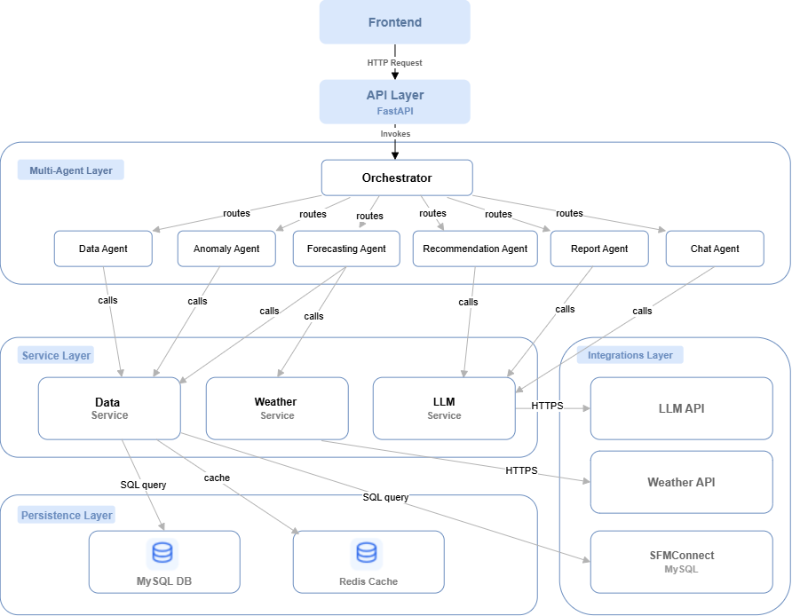
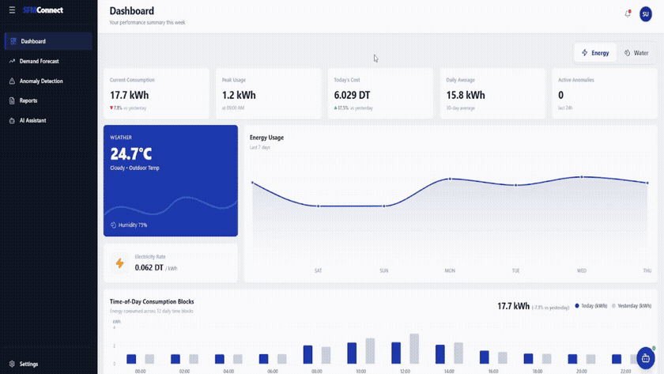

# Intelligent Multi-Agent System for Energy and Water Management

> **END-OF-STUDIES INTERNSHIP PROJECT**


---

## 📌 Project Overview

Modern smart-meter infrastructures capture fine-grained consumption data at sub-minute intervals. However, conventional monitoring systems remain **passive visualizers**: they plot historical consumption but leave future demand planning, drift identification, and operational guidance entirely to human manual analysis.

This project delivers an end-to-end **Intelligent Multi-Agent System (MAS)** that transforms raw utility data into autonomous, actionable intelligence for commercial and institutional facilities:

1. **Predictive Modeling**: Day-ahead (24-hour) horizon forecasting for electricity (kWh) and water (litres) using state-of-the-art Deep Learning and Gradient Boosted Trees.
2. **Unsupervised Anomaly Detection**: Deep LSTM Autoencoders coupled with dual-signal thresholding (point-level spikes + rolling collective drifts) to catch equipment faults and pipe leaks without requiring pre-labeled training anomalies.
3. **Explainable AI (XAI)**: Reconstructed baseline attribution translated by Large Language Models (Claude Sonnet 5) into plain-language diagnostic explanations of abnormal consumption.
4. **Autonomous Multi-Agent Orchestration**: A deterministic state-graph architecture built with LangGraph coordinating specialized deterministic and generative agents over a unified shared state.
5. **Interactive Full-Stack Platform**: Responsive React/TypeScript dashboard, automated PDF reporting engine, and an interactive natural-language assistant grounded in real-time telemetry.

--- 

## 🏛️ System Architecture

The platform is designed as a **6-Layer Modular Monolith**, ensuring strict decoupling between numerical inference pipelines, generative agents, and persistence services.



### Architectural Layers

* **Frontend Layer**: Built with React 18, TypeScript, Tailwind CSS, and Vite. Features interactive time-series charts, tariff tier tracking, anomaly inspection canvases, and an embedded AI conversational interface.
* **API Routing Layer**: FastAPI asynchronous server providing REST endpoints, session routing, request validation, and OpenAPI documentation.
* **Multi-Agent Layer (LangGraph)**: Orchestrates tasks as an acyclic state graph. Coordinates six specialized agents via a unified `SharedState` schema.
* **Service Layer**: Decouples business logic from external dependencies (`DataService` for queries and cache, `LLMService` for Claude API token management, and `WeatherService` for meteorological data).
* **Persistence Layer**: Relational database (MySQL) for durable entities (readings, user configurations, generated reports) and in-memory cache (Redis) for workflow checkpointing and sub-second analytical retrieval.
* **Integration Layer**: Ingests telemetry streams and utility tariff rate matrices.

---

## 🤖 Multi-Agent Orchestration

Rather than relying on a costly and non-deterministic single LLM orchestrator, execution is coordinated by a **deterministic intent-based router** implemented with **LangGraph**:

```
[Client Request]
       │
       ▼
┌───────────────────────────────────────────────────────────┐
│               Deterministic Orchestrator                  │
└──────┬──────────────────────┬──────────────────────┬──────┘
       │                      │                      │
       ▼                      ▼                      ▼
┌──────────────┐      ┌──────────────┐      ┌──────────────┐
│  Data Agent  │      │Forecast Agent│      │Anomaly Agent │   ◀── Deterministic
└──────┬───────┘      └──────┬───────┘      └──────┬───────┘       (No LLM calls)
       │                     │                     │
       └──────────────┬──────┴─────────────────────┘
                      ▼
             [ Shared State Sync ]
                      │
       ┌──────────────┼──────────────────────┐
       ▼              ▼                      ▼
┌──────────────┐┌──────────────┐      ┌──────────────┐
│  Rec. Agent  ││ Report Agent │      │  Chat Agent  │   ◀── Generative
└──────────────┘└──────────────┘      └──────────────┘       (Claude Sonnet 5)
```

| Agent | Processing Type | Core Responsibility |
|---|---|---|
| **Data Agent** | Deterministic | Executes SQL retrieval, missing data imputation, and hourly resampling. |
| **Forecasting Agent** | Deterministic (ML/DL) | Generates 24-hour day-ahead predictions using the selected production model. |
| **Anomaly Agent** | Deterministic (PyTorch) | Computes reconstruction loss over 24h sliding sequences via LSTM Autoencoder. |
| **Recommendation Agent**| Generative LLM | Formulates operational energy- and water-saving strategies based on active forecasts and anomalies. |
| **Report Agent** | Generative LLM | Assembles comprehensive audit documents and triggers programmatic PDF compilation. |
| **Chat Agent** | Generative LLM | Conversational co-pilot answering natural-language queries grounded in live database telemetry. |

> **Cost & Latency Optimization**: Deterministic agents handle all numerical and data-retrieval steps with 0 token overhead. LLM agents operate with isolated, task-specific system prompts (~450–990 tokens), preventing prompt bloat and keeping per-call inference costs below \$0.01.

---

## 🎬 Platform Demonstration & Operational Walkthrough

The following recording demonstrates the end-to-end multi-agent platform operating across its key user interfaces:



<p align="center">
  <a href="demo/demo.mp4"><b>▶ Watch the full demo video</b></a>
</p>

---

### Walkthrough Highlights

* **Unified Monitoring Dashboard**: Live telemetry tracking for energy (kWh) and water (L/h), utility tariff tier calculations, and 7-day consumption history.
* **24-Hour Day-Ahead Forecasting**: Real-time evaluation of predicted demand curves against incoming smart-meter streams, enabling proactive load balancing.
* **Unsupervised Anomaly Detection & XAI**: Visual error-margin tracking from the LSTM Autoencoder, paired with on-the-fly Claude-generated root-cause hypotheses explaining the deviation.
* **Interactive AI Assistant**: Conversational co-pilot querying the live LangGraph state to answer consumption questions, compute projected costs, and suggest immediate optimization measures.

---

## 🔬 Analytical Pipelines & Methodology

### 1. ⚡ Energy Demand Forecasting Pipeline
* **Telemetry**: ~16,300 hourly observations spanning October 2024 to August 2026.
* **Feature Engineering (139 features)**:
  * *Temporal & Calendar*: Sin/Cos cyclic encodings for hour-of-day, day-of-week, month; binary indicators for office working hours, weekends, and national holidays.
  * *Autoregressive Lags*: Consumption at key seasonal autocorrelation peaks ($t-24$, $t-48$, $t-168$).
  * *Rolling Statistics*: Rolling means, standard deviations, and min/max over 3h, 6h, 12h, 24h, and 168h windows.
  * *Exogenous Weather*: Ambient temperature, relative humidity, global solar radiation, and cooling/heating degree days.
* **Feature Selection**: Rigorous 6-stage reduction pipeline (Pearson correlation filtering, Variance Inflation Factor collinearity pruning, Random Forest Gini ranking, Permutation Importance, Recursive Feature Elimination, and LASSO L1 regularization) distilling 139 variables into the top **52 most predictive features**.
* **Model Validation**: 5-fold seasonal walk-forward cross-validation covering Summer 2025 through Summer 2026.

### 2. 💧 Water Demand Forecasting Pipeline
* **Telemetry**: 17,544 hourly observations from the Building Data Genome 2 (BDG2) office dataset.
* **Domain Challenge**: Heavily **zero-inflated time series (59% zero hours)** caused by unconsumed nighttime and weekend periods, causing standard percentage metrics (MAPE) to divide by zero and diverge.
* **Feature Engineering & Selection**: 32 domain features pruned to **15 essential predictors** combining mutual information and XGBoost split importance. The single most predictive feature identified was the learned *hourly occupancy probability profile*.
* **Evaluation Metrics**: Assessed using scale-independent metrics **MASE** and **RMSSE** against seasonal naïve baselines ($m=168$).

### 3. 🔍 Unsupervised Anomaly Detection Pipeline
* **Architecture**: LSTM Encoder-Decoder (`batch, 24, 1`) with an empirical latent bottleneck of dimension **12** selected via dimensionality sweep (evaluating dims 2 through 16):
  $$\text{Encoder: } \text{LSTM}(1 \to 32) \to \text{LSTM}(32 \to 12)$$
  $$\text{Decoder: } \text{Repeat}(24) \to \text{LSTM}(12 \to 32) \to \text{Linear}(32 \to 1)$$
* **Training Protocol**: Trained strictly on sanitized normal baseline sequences using Adam optimizer, Cosine Annealing learning rate schedule, and early stopping.
* **Dual-Signal Calibration**:
  $$\text{Point Threshold: } \tau_{\text{point}} = \mu_{\text{err}} + k_{\text{point}} \cdot \sigma_{\text{err}}$$
  $$\text{Smoothed Threshold: } \tau_{\text{smooth}} = \mu_{\text{smooth}} + k_{\text{smooth}} \cdot \sigma_{\text{smooth}}$$
  * *Energy*: Adaptive rolling 168-hour window calibration ($k_{\text{point}} = 3.5$, $k_{\text{smooth}} = 6.0$) to track evolving seasonal baselines.
  * *Water*: Fixed out-of-sample baseline calibration ($k_{\text{point}} = 3.0$, $k_{\text{smooth}} = 7.5$) on stable occupancy patterns.

---

## 🏆 Key Experimental Results

### ⚡ Energy Forecasting Benchmark (Winning Model)

Evaluated across the chronological holdout test set:

| Model | Architecture | $R^2$ Score | CV-RMSE | MAE | sMAPE |
|---|---|---|---|---|---|
| **BiGRU** 🏆 | 2-Layer Bidirectional GRU (lookback 168h) | **0.900** | **12.09%** | **0.044 kWh** | **6.00%** |

*BiGRU outmatched tree-based ensembles by processing the full 168-hour lookback window as a continuous temporal sequence, capturing sharp occupancy transitions and peak cooling loads.*

---

### 💧 Water Forecasting Benchmark (Winning Model)

Evaluated across the chronological 15% out-of-sample holdout:

| Model | Architecture | $R^2$ Score | MAE | MASE | RMSSE |
|---|---|---|---|---|---|
| **CatBoost** 🏆 | Gradient Boosted Decision Trees | **0.859** | **27.15 L/h** | **0.483** | **0.451** |

*Both MASE (0.483) and RMSSE (0.451) sit well below 1.0, beating the seasonal-naïve benchmark by over 50%. CatBoost delivered the lowest RMSSE across all candidates, minimizing high-magnitude peak errors.*

---

### 🔍 Anomaly Detection Results

| Utility Domain | Validation $R^2$ | Validation MAE | Detection Strategy | Real Anomalies Detected |
|---|---|---|---|---|
| **Energy** | **0.979** | 0.019 kWh | Adaptive Rolling Threshold | **5 events** (62 anomalous hours) |
| **Water** | **0.921** | 22.79 L/h | Fixed Baseline Threshold | **6 events** (96 anomalous hours) |

---

### 🧠 Explainable AI in Operation

Rather than surfacing opaque alert banners, the system translates mathematical autoencoder residuals into contextual operational diagnoses:

> **Example Diagnostic**:
> *"On July 13th at 14:00, active energy draw spiked to **1.85 kWh**, exceeding the model's reconstructed expected baseline of **0.92 kWh** ($\Delta = +101\%$, error margin $3.76\times$ above threshold). The sustained 22-hour duration during non-operational hours suggests an unmanaged HVAC chiller override or baseload control failure."*

---

### ⏱️ System Latency & Quality Metrics

All metrics experimentally measured on the fully deployed containerized stack:

| Request Category | Target SLA | Measured Latency | Operational Status |
|---|---|---|---|
| **API Health Ping** | $< 1.0\text{ s}$ | $0.001\text{ s} - 0.020\text{ s}$ | ✅ Met |
| **Cached Analytics Lookup** | $< 1.0\text{ s}$ | $0.008\text{ s} - 0.640\text{ s}$ | ✅ Met |
| **Cold-Start ML Inference** | $< 5.0\text{ s}$ | $0.820\text{ s} - 4.440\text{ s}$ | ✅ Met |
| **LLM Generative Response** | $< 4.0\text{ s}$ | $2.820\text{ s} - 5.100\text{ s}$ | ⚠️ Context-assembly bound |
| **Dashboard Initial Render (Cached)** | $< 2.0\text{ s}$ | $0.820\text{ s}$ | ✅ Met |

---

## 🚀 Deployment & Quick Start

The entire multi-tier environment (Frontend, FastAPI Backend, MySQL 8.0, Redis 7.0, and Adminer) is provisioned via Docker Compose with health checks and network isolation.

### 1. Clone & Environment Setup

```bash
git clone <repository_url>
cd project

# Copy environment template
cp .env.example .env
```

Configure your secrets inside `.env`:

```ini
MYSQL_ROOT_PASSWORD=your_secure_root_password
MYSQL_PASSWORD=your_secure_db_password
REDIS_PASSWORD=your_secure_redis_password
ANTHROPIC_API_KEY=your_claude_api_key
VITE_API_URL=http://localhost:8000
```

### 2. Launch the Stack

```bash
# Build and run containers in detached mode
docker-compose up -d

# Follow backend startup logs
docker-compose logs -f backend
```

### 3. Service Endpoints

| Component | Endpoint | Description |
|---|---|---|
| **Web Dashboard** | [http://localhost:3000](http://localhost:3000) | Interactive React Application |
| **REST API Documentation** | [http://localhost:8000/docs](http://localhost:8000/docs) | Swagger / OpenAPI UI |
| **Redis Cache UI** | [http://localhost:8001](http://localhost:8001) | RedisInsight Dashboard |
| **Database Administration** | [http://localhost:8080](http://localhost:8080) | Adminer *(Optional profile: `--profile tools`)* |

---

## 🔒 Security & Best Practices

* **Loopback Binding**: Every service port is bound strictly to `127.0.0.1` preventing inadvertent external exposure.
* **Zero Credential Hardcoding**: Complete separation of secrets via environment variables mounted read-only at runtime.
* **Deterministic Isolation**: Strict architectural barrier ensuring user SQL databases cannot be directly accessed by generative LLM components.
