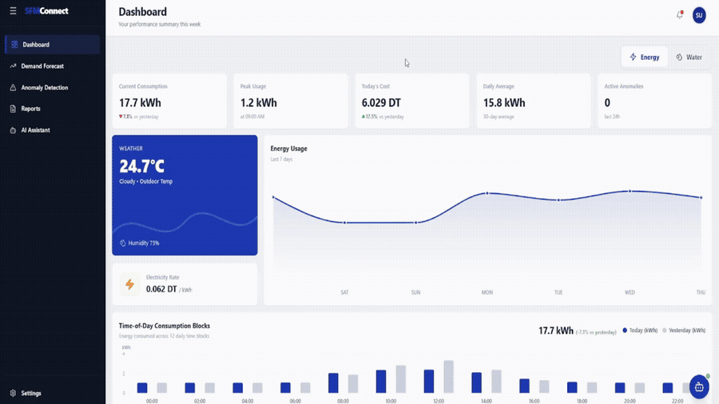

# Intelligent Multi-Agent System for Energy and Water Management

> **END-OF-STUDIES INTERNSHIP PROJECT**


[🎬 Demo](demo/)

---



---

## Overview

An existing IoT application for energy and water management collects fine-grained smart-meter data — yet remained purely passive, leaving forecasting, anomaly interpretation and guidance entirely to the user.

This project extends it with a **coordinated multi-agent system**: consumption is forecasted 24 hours ahead, anomalies are detected automatically, and results are translated into natural-language recommendations, structured reports and conversational answers — all in one platform.

---

## Architecture


---

## Agents

Six specialized agents, coordinated by a deterministic LangGraph orchestrator through a shared state — no direct agent-to-agent calls:

| Agent | Type | Role |
|---|---|---|
| **Data** | Deterministic | SQL retrieval and preprocessing |
| **Forecasting** | Deterministic | 24-hour-ahead ML/DL inference |
| **Anomaly** | Deterministic | LSTM Autoencoder detection |
| **Recommendation** | LLM (Claude) | Personalized consumption guidance |
| **Report** | LLM (Claude) | Structured weekly reports |
| **Chat** | LLM (Claude) | Natural-language Q&A grounded in validated data |

---

## Results

### ⚡ Energy Forecasting — BiGRU

Trained on ~16,300 hourly readings (Oct 2024 – Aug 2026):

| R² | CV-RMSE | MAE | sMAPE |
|---|---|---|---|
| **0.900** | **12.09%** | **0.044 kWh** | **6.00%** |

### 💧 Water Forecasting — CatBoost

Trained on the BDG2 public office dataset (17,544 hourly values, 2016–2017; 59% zero hours):

| R² | MAE (L/h) | MASE | RMSSE |
|---|---|---|---|
| **0.859** | **27.15** | **0.483** | **0.451** |

> MASE and RMSSE < 1 — beats the seasonal-naïve benchmark.

### 🔍 Anomaly Detection — LSTM Autoencoder

Trained on clean data only (unsupervised). Dual-signal threshold: point MSE + 4-hour smoothed MSE to catch both sudden spikes and sustained drifts:

| Domain | Val R² | Val MAE | Events detected |
|---|---|---|---|
| **Energy** | **0.979** | 0.019 kWh | **5 events** — 62 anomalous hours |
| **Water** | **0.921** | 22.79 L/h | **6 events** — 96 anomalous hours |

> Each alert is explained in plain language in the UI — actual vs. reconstructed value at the triggering hour.

### 🧠 Explainable AI

Every anomaly flagged by the LSTM Autoencoder is accompanied by a natural-language explanation generated by Claude, comparing the actual consumption to the model's expected reconstruction at the hour of highest deviation — so users understand **why** an event was flagged, not just **that** it was.

### ⚙️ Latency (Measured on Deployed System)

| Request | Target | Measured |
|---|---|---|
| API health check | < 1 s | 0.001 – 0.02 s ✅ |
| Cached results | < 1 s | 0.008 – 0.64 s ✅ |
| Cold-start ML inference | < 5 s | 0.82 – 4.44 s ✅ |
| LLM responses | < 4 s | 2.82 – 5.10 s ⚠️ |
| Dashboard load (cached) | < 2 s | 0.82 s ✅ |

---

## Deployment

Five Docker containers managed through a single Compose file — start the full stack with one command:

```bash
cp .env.example .env   # set MYSQL_ROOT_PASSWORD, MYSQL_PASSWORD, REDIS_PASSWORD, ANTHROPIC_API_KEY
docker-compose up -d
```

| Service | URL |
|---|---|
| Frontend | http://localhost:3000 |
| API / Swagger | http://localhost:8000 / http://localhost:8000/docs |
| RedisInsight | http://localhost:8001 |

> Datasets and trained models are not included (git-ignored) — train your own using the pipeline folders.
